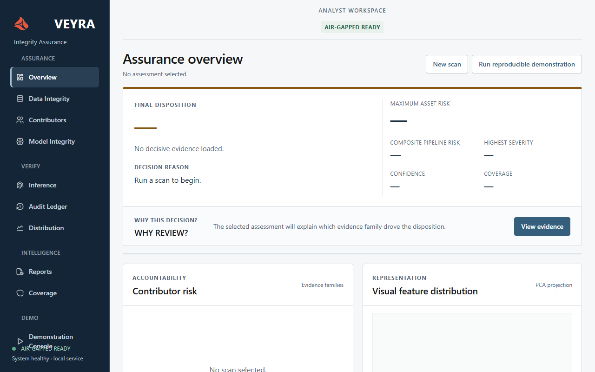

<p align="center">
  
</p>
<h1 align="center">Veyra</h1>
<p align="center"><strong>Computer Vision Integrity Assurance</strong></p>
<p align="center">Inspect the data. Verify the model. Trace the inference.</p>
<p align="center">
  <a href="#quick-start">Quick start</a> ·
  <a href="#investigation-workspace">Workspace</a> ·
  <a href="#evidence-and-limits">Evidence &amp; limits</a> ·
  <a href="#documentation">Documentation</a>
</p>

---

**Veyra is a local AI-security workstation for investigating the integrity of computer-vision pipelines.** It brings dataset findings, model fingerprints, signed inference records and audit history into one evidence-focused interface—so an analyst can see what triggered a decision, inspect its supporting evidence and identify checks that could not run.

Built with **Python · Flask · NumPy · PyTorch · Ed25519 · SQLite · locally vendored Tabler**.

> **Evidence before confidence.** Cryptographic failures establish integrity violations. Heuristic anomalies require analyst review. Composite scores and confidence are heuristic, not calibrated probabilities.

## Investigation workspace

| Area | What you can investigate |
| --- | --- |
| **Assurance overview** | Final disposition, decisive asset, policy reason, maximum asset risk, composite pipeline risk and coverage. |
| **Data integrity** | Image and annotation validation, dataset manifests, exact/near duplicates, label disagreement and reference-based outliers. |
| **Contributor intelligence** | Source-associated findings, affected samples and evidence families—with explicit attribution limits. |
| **Model integrity** | Trusted-reference byte hashes, behavioral probes, access-aware checks and experimental trigger reconstruction. |
| **Inference provenance** | Signed bindings between input, model, preprocessing, configuration and output; verification and separate replay-protected acceptance. |
| **Audit ledger** | Signed hash-chain history, first-invalid-link analysis and an altered-copy demonstration that leaves stored history unchanged. |
| **Distribution, coverage & reports** | Feature-shift measurements, unavailable checks, persisted assessments, JSON exports and printable HTML reports. |

The interface puts **decisions first, evidence second, metrics third**. A decisive cryptographic or contributor finding remains visible even when the composite pipeline score is lower.

<details>
<summary><strong>View the workstation shell</strong></summary>



*Repository screenshot captured for branding review; it does not establish full workflow or responsive validation.*

</details>

## Quick start

Use a Python environment compatible with the selected dependency versions. Provision packages before disconnected operation. Model-dependent demonstrations require a working PyTorch installation.

### 1. Get the project

```bash
git clone https://github.com/raskar-pratik/veyra.git
cd veyra
python -m venv .venv
```

Activate the environment:

```powershell
# Windows PowerShell
.venv\Scripts\Activate.ps1
```

```bash
# macOS / Linux
source .venv/bin/activate
```

### 2. Install and run

```bash
python -m pip install -r requirements.txt -r requirements-models.txt
python run.py
```

Open **[http://127.0.0.1:26228](http://127.0.0.1:26228)**.

The application binds to loopback. It is a local analyst tool, not a hosted multi-user service. Model files and pretrained weights are not fetched automatically.

### 3. Explore a real synthetic demonstration

Click **Run reproducible demonstration**. Veyra creates synthetic clean and attacked image datasets and local TorchScript models, executes scans, signs an inference record, and exercises tampering and replay scenarios.

Then follow the evidence:

1. Read the **Overview** disposition and its reason.
2. Inspect the linked **Data**, **Contributor** and **Model** evidence.
3. Verify an **Inference** record; distinguish signature verification from acceptance and replay policy.
4. Verify the **Audit Ledger** and inspect the altered-copy failure.
5. Review coverage gaps and export the assessment.

**Synthetic results demonstrate these fixtures, not general attack-detection accuracy.** Reports persist across restarts in normal application state.

For a standalone run:

```bash
python -m demo.runner --output demo/results-new
```

Use a new output directory. Seeded image bytes and model behavior are reproducible; UUIDs, keys, timestamps and TorchScript container bytes can differ between runs.

## Bring your own data and models

Place inputs under `local_state/imports/` and enter **relative paths** in the workstation. The browser API confines inputs to this subtree; it does not provide archive extraction or file-upload endpoints.

| Input | Supported layout or requirement |
| --- | --- |
| Classification folders | `dataset/class_name/image.png`; root images may be unlabeled. |
| COCO annotations | `dataset/annotations.json` with referenced images inside that dataset directory. |
| YOLO annotations | `dataset/images/…` and matching `dataset/labels/…txt`, or sibling image/text files. Class IDs are preserved. |
| Contributor metadata | Optional `contributors.json` mapping relative image paths to source names. |
| Clean reference | A separately supplied, trusted dataset in the same annotation format. |
| Models | Local TorchScript, safe PyTorch state dictionaries with architecture factories, and an optional ONNX Runtime adapter. |

Register a model in **Model Integrity**, acknowledge trust for executable local artifacts, and use its returned ID in a scan or inference form. The default probe/input convention is **RGB, 32×32, NCHW, float32 scaled by 1/255**. Other conventions require adapter integration; incompatible outputs are reported as failures.

Set `AEGISCV_STATE` before startup to choose another state directory. For local semantic checkpoints, see the [checkpoint provisioning guide](docs/checkpoint_provisioning.md). The existing `AEGISCV_ENCODER`, `AEGISCV_ENCODER_WEIGHTS` and `AEGISCV_ENCODER_SHA256` configuration names remain supported.

## Offline operation

The dashboard uses local CSS, JavaScript, icons and logo assets, including **Tabler 1.6.1**. No cloud API is required for the investigation workflow. Optional pretrained weights must be supplied locally by the operator.

For a disconnected machine, prepare a wheelhouse matching its operating system and Python version, transfer it through your approved process, then install:

```powershell
python -m pip install --no-index --find-links X:\wheelhouse -r requirements.txt
python -m pip install --no-index --find-links X:\wheelhouse -r requirements-models.txt
```

The repository also includes [`scripts/setup_offline.ps1`](scripts/setup_offline.ps1).

Offline design and static asset checks do not prove system-wide network isolation. Browser network observations apply only to the workflows and session actually measured.

## Evidence and limits

| Evidence | What it establishes—and what it does not |
| --- | --- |
| **Trusted-reference hash mismatch** | The observed artifact differs from the trusted reference. It does not identify who changed it or their intent. |
| **Valid signed inference record** | Protected content bindings and signature verify. It does not prove that the prediction is correct or the model is benign. |
| **Replay-protected acceptance** | The record passed the configured acceptance checks. Signature verification alone does not establish freshness. |
| **Valid ledger chain** | Available history passes its checks. Independent public-key pinning and trusted checkpoints are needed for meaningful external verification and truncation detection. |
| **Anomaly or contributor finding** | Evidence for investigation, not automatic proof of an attack or authorship. |
| **Experimental backdoor-like evidence** | Reconstruction anomalies may indicate suspicious model behavior but do not cryptographically confirm a backdoor. Recommended action: review. |

Additional boundaries:

- **No overall “Veyra accuracy” claim.** Synthetic precision, recall and false-positive results are specific to the recorded experiments.
- **Missing access stays visible.** Black-box models do not imply completed white-box checks; unavailable checks reduce coverage.
- **Semantic analysis has limits.** Without operator-supplied usable weights, a handcrafted encoder remains available and reports `FALLBACK`. Semantic performance gains remain unmeasured until representative evaluation is supplied. The default OOD threshold of 0.20 is an uncalibrated visual-feature heuristic.
- **Annotation checks are not object-level semantic verification.** Whole-image, singly labeled analysis remains distinct from COCO/YOLO geometry and consistency checks.
- **Known misses and false positives are retained.** Recorded handcrafted-fixture spectral recall is limited; backdoor experiments include missed attacks and clean-model false positives. See [hardening](docs/hardening.md) and [detector behavior](docs/detectors.md).
- **`ACCEPT` is bounded by the checks executed.** It does not establish the absence of unknown attacks.
- **Signing keys are a trust boundary.** Signatures cannot protect against an attacker who controls the signer and its keys.

## Validation and reproducibility

Run the checks in your installed environment:

```bash
python -m unittest discover -s tests -v
python scripts/check_ui_shell.py
node --check dashboard/static/app.js
node --check dashboard/static/workstation.js
```

The established regression baseline contains **50 tests**. Static gates check contracts and local assets; they are not substitutes for real browser testing.

| Experiment | Command | Purpose |
| --- | --- | --- |
| Hardening | `python -m experiments.hardening` | Detector diagnostics and backdoor reconstruction evidence. |
| Final validation | `python -m experiments.final_validation` | Procedural benchmark splits, calibration records, detector metrics and failure examples. |
| Stabilization | `python -m experiments.stabilization` | Duplicate diagnosis, acquisition statistics and held-out transformed-copy measurements. |

The procedural ten-class benchmark contains 200 training, 200 reference, 200 calibration and 300 held-out images. Only label disagreement and OOD thresholds are calibrated for this generated benchmark; application defaults remain unchanged. Encoder-bound profiles must be validated before explicit application.

Experiment outputs live under `experiments/results/`. Undefined metrics remain null/N/A. Do not overwrite frozen evidence to make a result look better.

## Record a walkthrough

The [LinkedIn recording guide](docs/linkedin_video.md) covers the demonstration sequence and its interpretation boundaries. With the project dependencies, Playwright and Chrome installed:

```bash
python -m pip install playwright
python scripts/record_linkedin_demo.py --channel chrome
```

The helper uses isolated synthetic demo state. Review the exported video and telemetry before publishing; a successful recording is evidence of the exercised workflows, not complete application validation.

## Architecture

| Directory | Responsibility |
| --- | --- |
| `app/` | REST routes, background orchestration and SQLite persistence |
| `adapters/` | Dataset and model integrations |
| `core/` | Findings, configuration, risk and coverage contracts |
| `detectors/` | Independent data, model and distribution checks |
| `provenance/` | Signed records, replay policy and ledger verification |
| `dashboard/` | Local HTML, CSS, JavaScript and vendored assets |
| `reports/` | JSON and printable HTML reports |
| `attack_simulator/`, `demo/` | Seeded attack fixtures and reproducible walkthroughs |
| `experiments/`, `tests/` | Measured evaluations and regression coverage |

## Documentation

- **Understand:** [Architecture](docs/architecture.md) · [Detectors](docs/detectors.md) · [Attack coverage](docs/attack_coverage.md)
- **Interpret:** [Decision policy](docs/decision_policy.md) · [Assurance schema](docs/assurance_schema.md) · [Hardening](docs/hardening.md)
- **Integrate:** [API](docs/api.md) · [Checkpoint provisioning](docs/checkpoint_provisioning.md)
- **Verify:** [Security](docs/security.md) · [Verification](docs/verification.md) · [Audit](docs/audit.md)
- **Present:** [Demo guide](docs/demo.md) · [Recording guide](docs/linkedin_video.md) · [UI integration](docs/ui/tabler_integration.md)
- **Dependencies:** [Third-party notices](THIRD_PARTY_NOTICES.md)

---

**Previously AegisCV.** Veyra retains the original internal identifiers, environment variables, historical audits and frozen benchmark names for compatibility and traceability.
