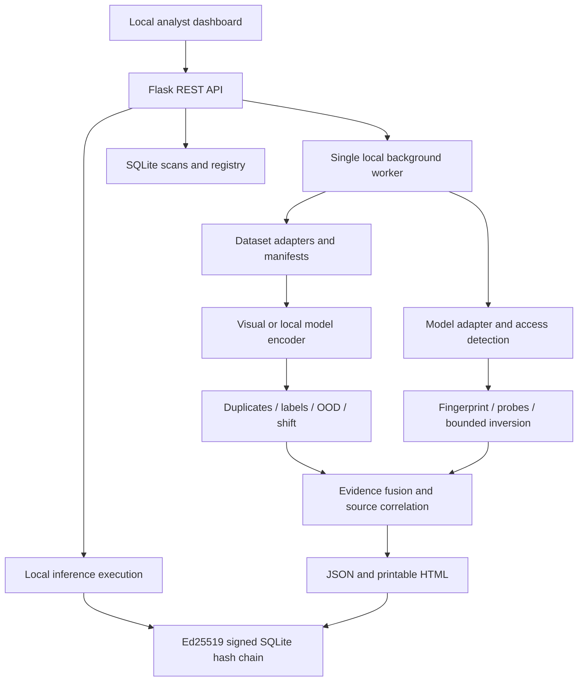

# Architecture



The detector layer has no Flask dependency. `Finding` is the common serialized evidence schema. Orchestration isolates detector exceptions and reports unavailable/failed tests. A single worker bounds concurrent ML work, while SQLite transactions serialize ledger writes. A job is complete only after report persistence.

Configuration is a validated `Config` dataclass and is accepted as JSON under `POST /api/scans.config`. Dataset formats are adapter concerns. The current runtime supports classification tensor outputs; unsupported output shapes are surfaced explicitly.

Local learned embeddings:

```python
from adapters.models.runtime import ModelAdapter
from detectors.data_integrity.features import LocalModelEncoder
from app.services.scanner import scan_dataset
feature_model = ModelAdapter('local_features.torchscript', 'torchscript', trusted=True)
report = scan_dataset('images', reference='reference',
                      encoder=LocalModelEncoder(feature_model, size=(224,224)))
```

The supplied feature model must already implement the desired normalization/feature head beyond RGB scaling. No weights are fetched. PyTorch state dictionaries require a locally authored factory, e.g. `ModelAdapter(path,'pytorch',factory=lambda:MyArchitecture())`; arbitrary serialized modules are never loaded.

The scan manifest is rechecked before report generation to reject concurrent dataset/reference changes. Input images are read once into bytes for inference. Runtime model identity is rechecked before inference. For adversarial concurrent filesystem access, use an immutable staging area and stronger process isolation.

The architecture is unchanged during hardening. `FeatureEncoder` formalizes `encode_image`, `encode_batch`, `embedding_dimension`, `encoder_id`, and `encoder_hash`; legacy `encode` remains an alias. `CachedEncoder` stores checksummed float32 vectors in SQLite and invalidates on image or encoder identity changes. ResNet18 is constructed with `weights=None` and then loads a local `weights_only=True` state dictionary. Strict architecture loading prevents accidentally using an incompatible checkpoint. The hash includes weights, preprocessing, runtime versions and batch configuration.

The same selected embeddings feed near-duplicate validation, label/OOD analysis, spectral signatures and distribution comparison; their findings feed contributor aggregation. Activation analysis intentionally uses the contributed model's penultimate representation rather than claiming generic encoder features came from that model. Report additions are backward-compatible; older reports without encoder/runtime metadata still render.
